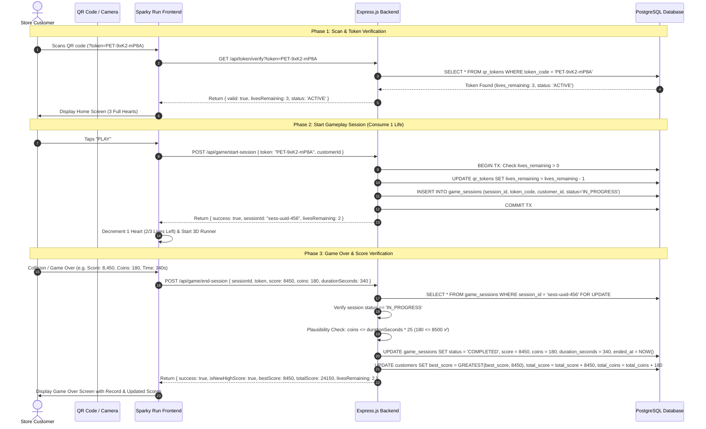

# Popular Electricals - QR Token & Gameplay Lifecycle API Specification

## 1. Executive Summary & Architecture

This document specifies the server-authoritative QR Token, Session, and Score verification architecture for **Popular Electricals of Qatar (Sparky Run)**.

### Core Objectives:
1. **QR Token Access**: Customers enter the game by scanning in-store QR codes formatted with a unique URL parameter:
   ```text
   https://sparkyrun.gamefaktory.com/?token=PET-9xK2-mP8A
   ```
2. **3 Gameplays per Token**: Every QR token awards exactly **3 gameplays (3 lives)**.
3. **Database-Authoritative Lives**: Token lives are tracked and decremented strictly within database transactions on the server. Client-side `localStorage` cannot be manipulated to grant extra lives.
4. **Session Handshake & Anti-Cheat**: Every run receives a unique, single-use `sessionId` upon launch. At game over, the backend verifies that the session is valid, was in progress, has not been submitted previously, and satisfies the physical coin rate constraint ($\le 25\text{ coins/sec}$).
5. **Multi-Token Customer Lifetime Accrual**: Customers can scan multiple tokens over time across showroom visits. Every gameplay updates their customer profile:
   - **High Score (`best_score`)**: Highest single run (anchors their Leaderboard ranking).
   - **Cumulative Total Score (`total_score`)**: Sum of all runs across all tokens.
   - **Cumulative Coins (`total_coins`)**: Accumulated towards store merchandise rewards.

---

## 2. End-to-End Sequence Diagram



---

## 3. PostgreSQL Database Schema

```sql
-- 1. Customers Table (Persistent customer identity across multiple tokens)
CREATE TABLE IF NOT EXISTS customers (
    id VARCHAR(64) PRIMARY KEY,               -- e.g. 'pop_1729661234_ab12'
    name VARCHAR(100) NOT NULL,
    country_code VARCHAR(10) NOT NULL,        -- '+974'
    phone VARCHAR(20) NOT NULL UNIQUE,        -- '55123456'
    full_phone VARCHAR(30) NOT NULL UNIQUE,   -- '+974 55123456'
    consent BOOLEAN DEFAULT TRUE,
    best_score INT DEFAULT 0,                 -- All-time high score (for Leaderboard)
    total_score BIGINT DEFAULT 0,             -- Cumulative lifetime score across all runs
    total_coins INT DEFAULT 0,                -- Cumulative coins for store vouchers
    registered_at TIMESTAMP WITH TIME ZONE DEFAULT NOW(),
    updated_at TIMESTAMP WITH TIME ZONE DEFAULT NOW()
);

-- 2. QR Tokens Table (Issued in showroom, on flyers, or customer receipts)
CREATE TABLE IF NOT EXISTS qr_tokens (
    token_code VARCHAR(32) PRIMARY KEY,       -- e.g. 'PET-9xK2-mP8A'
    customer_id VARCHAR(64) REFERENCES customers(id), -- Bound upon first play/login
    initial_lives INT DEFAULT 3,
    lives_remaining INT DEFAULT 3,             -- Server-authoritative decrement
    status VARCHAR(20) DEFAULT 'ACTIVE',      -- 'ACTIVE', 'EXHAUSTED', 'REVOKED'
    created_at TIMESTAMP WITH TIME ZONE DEFAULT NOW(),
    last_played_at TIMESTAMP WITH TIME ZONE,
    expires_at TIMESTAMP WITH TIME ZONE DEFAULT (NOW() + INTERVAL '30 days')
);

-- 3. Individual Game Sessions Table (One-time use runs & anti-cheat audit)
CREATE TABLE IF NOT EXISTS game_sessions (
    session_id UUID PRIMARY KEY DEFAULT gen_random_uuid(),
    token_code VARCHAR(32) NOT NULL REFERENCES qr_tokens(token_code),
    customer_id VARCHAR(64) NOT NULL REFERENCES customers(id),
    score INT DEFAULT 0,
    coins INT DEFAULT 0,
    duration_seconds INT DEFAULT 0,
    status VARCHAR(20) DEFAULT 'IN_PROGRESS', -- 'IN_PROGRESS', 'COMPLETED', 'ABANDONED'
    started_at TIMESTAMP WITH TIME ZONE DEFAULT NOW(),
    ended_at TIMESTAMP WITH TIME ZONE
);

-- Optimization Indexes
CREATE INDEX IF NOT EXISTS idx_customers_best_score ON customers(best_score DESC);
CREATE INDEX IF NOT EXISTS idx_qr_tokens_customer ON qr_tokens(customer_id);
CREATE INDEX IF NOT EXISTS idx_game_sessions_customer ON game_sessions(customer_id);
CREATE INDEX IF NOT EXISTS idx_game_sessions_token ON game_sessions(token_code);
```

---

## 4. REST API Endpoints Specification

### 1. Verify / Lookup QR Token
Checks if a token exists, its remaining lives, and whether it is already bound to a customer.

- **Method**: `GET`
- **Route**: `/api/token/verify`
- **Query Parameters**:
  - `token` (string, required): e.g. `PET-9xK2-mP8A`
- **Success Response (200 OK)**:
  ```json
  {
    "valid": true,
    "token": "PET-9xK2-mP8A",
    "livesRemaining": 3,
    "status": "ACTIVE",
    "boundCustomerId": null,
    "boundCustomerName": null
  }
  ```
- **Error Response (404 Not Found)**:
  ```json
  {
    "valid": false,
    "token": "INVALID-CODE",
    "livesRemaining": 0,
    "status": "INVALID",
    "error": "QR Token not recognized. Please scan a valid showroom code."
  }
  ```

---

### 2. Start Game Session (Consumes 1 Life)
Atomically decrements 1 life from the token and issues a unique `sessionId`.

- **Method**: `POST`
- **Route**: `/api/game/start-session`
- **Request Body**:
  ```json
  {
    "token": "PET-9xK2-mP8A",
    "customerId": "pop_1729661234_ab12"
  }
  ```
- **Business Logic (Server)**:
  1. Lookup `qr_tokens` record for `token_code`.
  2. Verify `status == 'ACTIVE'` and `lives_remaining > 0`.
  3. If `customer_id` is null on token, bind it to this `customerId`. If already bound to a different customer, reject with 403.
  4. In a transaction, decrement `lives_remaining = lives_remaining - 1`.
  5. If `lives_remaining == 0`, set `status = 'EXHAUSTED'`.
  6. Insert `game_sessions` row with status `'IN_PROGRESS'`.
- **Success Response (200 OK)**:
  ```json
  {
    "success": true,
    "sessionId": "a2b4c6d8-e0f2-4a6b-8c0d-1e2f3a4b5c6d",
    "livesRemaining": 2
  }
  ```
- **Rejection Response (400 Bad Request)**:
  ```json
  {
    "success": false,
    "livesRemaining": 0,
    "error": "No lives remaining for this QR token. Please scan a new QR code in-store."
  }
  ```

---

### 3. End Game Session (Submits Run Score & Cumulative Update)
Verifies session ID and run plausibility, saves the individual run, and updates the customer's high score and cumulative total score.

- **Method**: `POST`
- **Route**: `/api/game/end-session`
- **Request Body**:
  ```json
  {
    "sessionId": "a2b4c6d8-e0f2-4a6b-8c0d-1e2f3a4b5c6d",
    "token": "PET-9xK2-mP8A",
    "customerId": "pop_1729661234_ab12",
    "score": 8450,
    "coins": 180,
    "durationSeconds": 340
  }
  ```
- **Business Logic (Server)**:
  1. Retrieve `game_sessions` by `sessionId`.
  2. Verify that `status == 'IN_PROGRESS'` (prevents duplicate submission / replay attack).
  3. **Plausibility Anti-Cheat Check**:
     $$\text{coins} \le \text{durationSeconds} \times 25$$
     If coins exceed the physical upper limit (including future Super Coins and turbo multipliers), flag as suspicious or reject.
  4. Update `game_sessions`: `status = 'COMPLETED'`, `score`, `coins`, `duration_seconds`, `ended_at = NOW()`.
  5. Update `customers`:
     - `best_score = GREATEST(best_score, score)`
     - `total_score = total_score + score`
     - `total_coins = total_coins + coins`
     - `updated_at = NOW()`
  6. Return updated stats and rank calculations.
- **Success Response (200 OK)**:
  ```json
  {
    "success": true,
    "isNewHighScore": true,
    "score": 8450,
    "coins": 180,
    "bestScore": 8450,
    "totalScore": 24150,
    "totalCoins": 520,
    "livesRemaining": 2,
    "rankToday": 1,
    "rankGlobal": 3
  }
  ```

---

## 5. Reference Implementation (Node.js / Express + PostgreSQL)

```javascript
// Express.js Route Handlers
const { Router } = require('express');
const router = Router();
const pool = require('./db'); // pg pool

// 1. Verify Token
router.get('/api/token/verify', async (req, res) => {
  const { token } = req.query;
  if (!token) return res.status(400).json({ valid: false, error: 'Token required' });

  try {
    const { rows } = await pool.query(
      `SELECT t.*, c.name as customer_name 
       FROM qr_tokens t 
       LEFT JOIN customers c ON t.customer_id = c.id 
       WHERE t.token_code = $1`,
      [token.trim()]
    );

    if (rows.length === 0) {
      return res.status(404).json({ valid: false, status: 'INVALID', error: 'Token not found' });
    }

    const t = rows[0];
    res.json({
      valid: t.status === 'ACTIVE' && t.lives_remaining > 0,
      token: t.token_code,
      livesRemaining: t.lives_remaining,
      status: t.status,
      boundCustomerId: t.customer_id,
      boundCustomerName: t.customer_name
    });
  } catch (err) {
    res.status(500).json({ valid: false, error: err.message });
  }
});

// 2. Start Session (Atomically Decrement Life)
router.post('/api/game/start-session', async (req, res) => {
  const { token, customerId } = req.body;
  if (!token || !customerId) {
    return res.status(400).json({ success: false, error: 'Token and customerId required' });
  }

  const client = await pool.connect();
  try {
    await client.query('BEGIN');

    // Lock token row
    const { rows: tRows } = await client.query(
      `SELECT * FROM qr_tokens WHERE token_code = $1 FOR UPDATE`,
      [token]
    );

    if (tRows.length === 0) {
      await client.query('ROLLBACK');
      return res.status(404).json({ success: false, error: 'Token not found' });
    }

    const tokenRow = tRows[0];
    if (tokenRow.lives_remaining <= 0 || tokenRow.status !== 'ACTIVE') {
      await client.query('ROLLBACK');
      return res.status(400).json({ success: false, livesRemaining: 0, error: 'No lives remaining' });
    }

    // Bind token if not already bound
    if (!tokenRow.customer_id) {
      await client.query(
        `UPDATE qr_tokens SET customer_id = $1 WHERE token_code = $2`,
        [customerId, token]
      );
    } else if (tokenRow.customer_id !== customerId) {
      await client.query('ROLLBACK');
      return res.status(403).json({ success: false, error: 'Token already bound to another customer' });
    }

    // Decrement life
    const newLives = tokenRow.lives_remaining - 1;
    const newStatus = newLives === 0 ? 'EXHAUSTED' : 'ACTIVE';
    await client.query(
      `UPDATE qr_tokens SET lives_remaining = $1, status = $2, last_played_at = NOW() WHERE token_code = $3`,
      [newLives, newStatus, token]
    );

    // Create active session
    const { rows: sRows } = await client.query(
      `INSERT INTO game_sessions (token_code, customer_id, status) VALUES ($1, $2, 'IN_PROGRESS') RETURNING session_id`,
      [token, customerId]
    );

    await client.query('COMMIT');
    res.json({
      success: true,
      sessionId: sRows[0].session_id,
      livesRemaining: newLives
    });
  } catch (err) {
    await client.query('ROLLBACK');
    res.status(500).json({ success: false, error: err.message });
  } finally {
    client.release();
  }
});

// 3. End Session (Plausibility, High Score, Cumulative Score)
router.post('/api/game/end-session', async (req, res) => {
  const { sessionId, token, customerId, score, coins, durationSeconds } = req.body;
  if (!sessionId || !customerId) {
    return res.status(400).json({ success: false, error: 'Missing session parameters' });
  }

  const client = await pool.connect();
  try {
    await client.query('BEGIN');

    const { rows: sRows } = await client.query(
      `SELECT * FROM game_sessions WHERE session_id = $1 FOR UPDATE`,
      [sessionId]
    );

    if (sRows.length === 0 || sRows[0].status !== 'IN_PROGRESS') {
      await client.query('ROLLBACK');
      return res.status(400).json({ success: false, error: 'Session not active or already submitted' });
    }

    // Anti-cheat verification: max 25 coins/second
    const duration = Math.max(1, Number(durationSeconds) || 1);
    if (coins > duration * 25) {
      await client.query('ROLLBACK');
      return res.status(400).json({ success: false, error: 'Run exceeded maximum physical coin rate' });
    }

    // Complete session
    await client.query(
      `UPDATE game_sessions 
       SET status = 'COMPLETED', score = $1, coins = $2, duration_seconds = $3, ended_at = NOW() 
       WHERE session_id = $4`,
      [score, coins, duration, sessionId]
    );

    // Update customer lifetime stats
    const { rows: cRows } = await client.query(
      `UPDATE customers 
       SET total_score = total_score + $1,
           total_coins = total_coins + $2,
           best_score = GREATEST(best_score, $1),
           updated_at = NOW()
       WHERE id = $3
       RETURNING best_score, total_score, total_coins`,
      [score, coins, customerId]
    );

    const cust = cRows[0];
    const isNewHighScore = score >= cust.best_score && score > 0;

    // Fetch token lives
    const { rows: tRows } = await client.query(
      `SELECT lives_remaining FROM qr_tokens WHERE token_code = $1`,
      [token]
    );
    const livesRemaining = tRows[0]?.lives_remaining ?? 0;

    await client.query('COMMIT');

    res.json({
      success: true,
      isNewHighScore,
      score,
      coins,
      bestScore: cust.best_score,
      totalScore: cust.total_score,
      totalCoins: cust.total_coins,
      livesRemaining
    });
  } catch (err) {
    await client.query('ROLLBACK');
    res.status(500).json({ success: false, error: err.message });
  } finally {
    client.release();
  }
});

module.exports = router;
```
